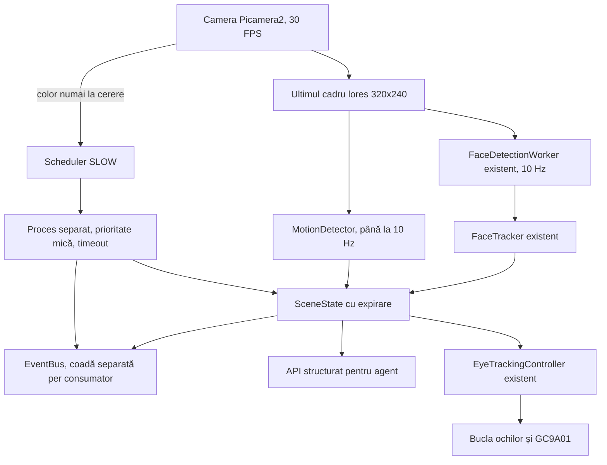

# Poro perception system

FAST VISION păstrează face tracking-ul existent și adaugă motion, starea scenei
și evenimente. SLOW VISION rulează într-un proces separat, la interval sau la
cererea agentului. Nu este conectat niciun LLM și nu sunt generate detecții fictive.

## Pornire

Python de sistem, fără virtual environment. Nu sunt necesare pachete noi față
de face tracking: `python3-picamera2`, `python3-opencv`, `opencv-data`.

```bash
cd /home/poro/Poro
/usr/bin/python3 vision_test.py
# Depanare cu evenimente JSON și starea scenei:
/usr/bin/python3 vision_test.py --events --scene
# Expresie/durată opționale:
/usr/bin/python3 vision_test.py --emotion love --duration 30
# Teste fără hardware:
/usr/bin/python3 -m unittest tests.test_perception -v
```

Rulează o singură comandă hardware odată; oprește cu Ctrl+C. `main.py` rămâne
programul de ochi fără cameră. Pinii, asocierea display-urilor, rotațiile,
clipitul și smoothing-ul ochilor sunt păstrate.

## Arhitectură



- `camera.py`: unicul proprietar al camerei; luminanță lores continuă și
  captură color din main numai la cerere, fără schimbarea modului camerei.
- `face_detector.py`, `pipeline.py`, `face_tracker.py`, `eye_control.py`:
  componentele existente, fără rescrierea algoritmului de tracking.
- `perception.py`: coordonatorul și API-ul public. Agregarea FAST rulează la 20 Hz.
- `motion.py`: blur/diferențe/prag pe 160×120; mișcare vizuală nesemantică.
- `events.py`: abonamente cu cozi limitate, fără callback-uri ale agentului în
  thread-urile camerei. `scene_events.py`: tranziții și limitarea notificărilor.
- `scene.py`: snapshot-uri JSON independente și expirare la citire, fără pixeli.
- `slow.py`: proces `spawn` cu prioritate redusă și OpenCV pe un fir. Maximum
  un job activ și o cerere manuală în așteptare; cererile repetate se comasează.
- `analyzers.py`: contractul extensiilor și statistici simple ale imaginii.
  Analyzer-ul implicit raportează luminozitate/contrast și `semantic_analysis: false`.

Un blocaj SLOW produce `perception_error` și terminarea procesului lent;
următoarea cerere îl recreează. FAST și ochii continuă. Modelele adăugate ulterior
pot totuși consuma CPU/memorie: limitează firele și măsoară performanța pe Pi.

## API pentru viitorul agent

Import: `from vision.perception import PerceptionSystem`.

Aplicația creează o singură instanță prin `with PerceptionSystem() as perception`
și o transmite modulelor. `vision_test.py` este exemplul complet cu ochii reali.
Nu deschide altă cameră în agent. Protejează pornirea aplicației cu
`if __name__ == "__main__":`, necesar pentru procesul `spawn`.
Pentru o nouă sesiune, creează o instanță nouă.

Pe instanța deja pornită:

```python
scene = perception.get_current_scene_state()  # dict JSON, fără imagini
people = perception.get_visible_people()
objects = perception.get_visible_objects()
present = perception.has_person()
position = perception.primary_person_position()  # {"x": ..., "y": ...} sau None
accepted = perception.request_slow_analysis()     # întoarce imediat
inspection = perception.inspect_scene(timeout=16)  # așteaptă o analiză nouă; doar din worker
```

Snapshot-ul conține `schema_version`, `clock`, `sampled_at`, `running`, `error`,
`people`, `people_fresh`, `people_observed_at`, `primary`, `has_person`, `motion`,
`motion_fresh`, `objects`, `gestures`, `scene_analysis`, `slow`, `capabilities`.

- `people` sunt detecții de fețe frontale, nu identități. `detection_index` este
  local cadrului, fără persistență. Lista brută poate conține fețe înainte de
  confirmarea țintei pentru ochi.
- Pozițiile agentului: x/y în [-1,1], centru (0,0), dreapta/jos pozitive.
  Bbox: `[x,y,width,height]` în [0,1], origine în colțul stânga-sus al imaginii.
- `FACE_INVERT_X/Y` corectează numai `primary.eye_target` și
  `get_tracking_target()`. `primary_person_position()` rămâne în coordonatele camerei.
- `has_person()` include holding-ul de 1,5 s. Poți avea `people=[]` și
  `has_person=True` temporar. Pentru vizibilitate strictă verifică lista și
  `people_fresh`. După expirare `primary=None` și `has_person=False`.
- `objects=[]` nu înseamnă că un detector a verificat absența obiectelor.
  Verifică `capabilities`: implicit obiectele și gesturile sunt `not_configured`.
  Înainte de încărcarea extensiilor pot fi `unknown`; ulterior `fresh`, `stale`
  sau `error`. Starea fiecărui analyzer apare în `slow`.
- Timestamp-urile sunt `time.monotonic()` pe acest Pi, nu UTC; nu se compară
  între reboot-uri. `observed_at` este timpul cadrului, nu finalul inferenței.
- Snapshot-urile sunt copii serializabile cu `json.dumps(scene)`. Rezultatele
  expirate nu rămân în listele vizibile, nici dacă nu mai sosesc rezultate noi.
  După oprire nu rămân persoane sau obiecte declarate vizibile.

Captură explicită pentru AI, din thread-ul agentului/SLOW, nu din eye loop:

```python
frame = perception.capture_frame_for_ai(timeout=1.0)
metadata = frame.metadata()
rgb = frame.rgb             # numpy RGB read-only, implicit maximum 640x480
jpeg = frame.jpeg_bytes()   # bytes; JPEG este creat numai la această cerere
```

Captura așteaptă următorul cadru și poate ridica `TimeoutError`. Nu salvează și
nu transmite imagini către servicii. Cererile simultane pot împărți același
cadru. Redimensionarea/JPEG rulează la apelant; callback-ul camerei doar copiază
imaginea cerută. Ordinea BGR din streamul Picamera2 RGB888 este convertită în RGB.

## Evenimente

Fiecare modul are propriul abonament, consumat în bucla sa:

```python
with perception.subscribe({"person_seen", "person_lost", "motion_detected"}) as events:
    event = events.poll(timeout=0.5)
    if event is not None:
        message = event.to_dict()
    batch = events.drain(limit=16)  # alternativ: fără așteptare
    dropped = events.dropped_count
```

`subscribe()` fără argumente primește toate tipurile. Evenimentul conține
`schema_version`, `sequence`, `type`, `source`, `observed_at`, `emitted_at`,
`clock`, `data`. Datele unui abonat nu pot altera mesajul altuia.

| Eveniment | Semnificație |
| --- | --- |
| `person_seen` | Apare o țintă confirmată după absență |
| `person_lost` | Expiră ultima țintă, după hold-ul existent |
| `person_position` | Poziție/stare, implicit maximum 4/s |
| `multiple_people` | Se schimbă numărul de fețe, înainte/acum cel puțin două; include `count`, `active` |
| `motion_detected` | Început/sfârșit (`active` true/false) și notificări periodice în timpul mișcării |
| `object_detected` | O extensie întoarce obiecte valide |
| `gesture_detected` | O extensie întoarce gesturi valide |
| `scene_updated` | O extensie întoarce analiza scenei |
| `perception_error` | Eroare FAST/SLOW; `source` indică originea |

`person_seen/lost` indică prezența oricărei ținte confirmate (`scope=any_person`),
nu intrarea/ieșirea fiecărui individ. Nu există încă identități persistente.

Coada are implicit 64 evenimente per abonat. Când se umple, elimină cel mai
vechi și crește `dropped_count`; producătorul nu așteaptă consumatorul.
După overflow, resincronizează agentul prin `get_current_scene_state()`.
Nu este un jurnal durabil și nu garantează livrarea fiecărei tranziții.

## Extensii SLOW

`SLOW_ANALYZERS` conține căi `"modul:ClasaAnalyzer"`. Clasa importabilă trebuie
să aibă constructor fără argumente, `capabilities` (tuple cu `objects`,
`gestures` și/sau `scene`) și `analyze(frame: AIFrame) -> dict`.

Rezultatul poate conține numai chei declarate în `capabilities`:

- `objects`: listă de dict-uri cu `label`, `confidence` în [0,1], `bbox` normalizat.
- `gestures`: listă cu `label`, `confidence`; `bbox` opțional.
- `scene`: dict JSON cu informații structurate.

Listă goală = nicio detecție în acel cadru. Rezultatele sunt validate înainte
de publicare: coordonate, NaN, maximum 100 detecții/categorie și 64 KiB JSON.
Nu include imagini/base64. Păstrează modelul în instanță, fără reîncărcare per cadru.
Factory-urile sunt cod local de încredere. Toți analyzerii SLOW împart un proces;
unul blocat poate întârzia ceilalți analyzeri SLOW, dar nu execută cod în FAST.

Nu este instalat încă un model de obiecte/gesturi. Singura extensie implicită,
`SceneMetricsAnalyzer`, calculează statistici reale, fără interpretare semantică.

## Configurare

Setările existente `FACE_*`, `TRACKING_*`, `GAZE_SMOOTHING`, rotațiile și pinii
rămân păstrate. `TRACKING_MIRROR_X=False` evită anularea lui `FACE_INVERT_X=True`.

| Setare | Rol |
| --- | --- |
| `PERCEPTION_FAST_FPS=20` | Rata agregării FAST |
| `PERCEPTION_EVENT_CAPACITY=64` | Memorie limitată per abonat |
| `PERCEPTION_PEOPLE_TTL=0.75` | Vechime maximă pentru vizibilitate/motion |
| `PERSON_POSITION_INTERVAL=0.25` | Rata notificărilor de poziție |
| `MOTION_ENABLED`, `MOTION_FPS=10` | Activare/frecvență motion |
| `MOTION_PIXEL_THRESHOLD`, `MOTION_MIN_FRACTION` | Sensibilitatea motion |
| `MOTION_EVENT_INTERVAL=1` | Notificări periodice; tranzițiile sunt imediate |
| `AI_FRAME_MAX_SIZE=(640,480)`, `AI_FRAME_TIMEOUT=1` | Captura la cerere |
| `SLOW_VISION_INTERVAL=5` | Interval după job; 0 = numai la cerere |
| `SLOW_STARTUP_TIMEOUT=10` | Buget separat pentru pornirea procesului |
| `SLOW_VISION_TIMEOUT=3` | Bugetul analizei, inclusiv inițializarea modelelor |
| `SLOW_RESULT_TTL=12` | Expirarea rezultatelor lente |
| `SLOW_ANALYZERS` | Factory-uri; tuple gol dezactivează SLOW |

Repornește după modificări. Consultă `check_health()` în aplicația proprietar;
erorile FAST opresc testul hardware, erorile SLOW permit continuarea FAST.

## Verificări și limite

Testele unitare verifică distribuția, overflow-ul, izolarea datelor, evenimentele
person/multiple_people, regresiile tracker-ului existent, expirarea scenei,
motion și procesul SLOW (succes, rezultat invalid, timeout). Datele sintetice
sunt fixtures numai în teste; runtime-ul folosește camera reală.

La testul cu ambele ecrane, motion și scene metrics active: aproximativ 30 FPS
cameră, 10 detecții/s și 16–17 FPS ochi, comparabil cu versiunea precedentă.
Transferurile SPI și rotațiile fine existente limitează în continuare rata ochilor.
`--events`/`--scene` sunt opțiuni de depanare, dezactivate implicit.

Haar poate rata profiluri/fețe mici și poate produce detecții false. Mișcarea
camerei, autofocusul sau schimbările luminii pot activa motion. Nu există
recunoaștere facială sau numărare garantată a tuturor oamenilor. Avertismentele
libcamera existente pentru `imx708_wide` nu au împiedicat captura.

Referințe: [manual Picamera2](https://datasheets.raspberrypi.com/camera/picamera2-manual.pdf),
[ordinea canalelor Picamera2](https://github.com/raspberrypi/picamera2/blob/main/picamera2/request.py),
[OpenCV motion prin diferențe de cadre](https://opencv.org/opencv-g-api/).
